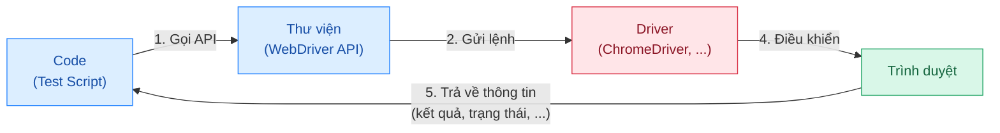

# 1. So sánh WebDriver, IDE và Grid

| Tiêu chí       | WebDriver                                                                                                              | Selenium IDE                                                                       | Selenium Grid                                                                                  |
| -------------- | ---------------------------------------------------------------------------------------------------------------------- | ---------------------------------------------------------------------------------- | ---------------------------------------------------------------------------------------------- |
| Mục đích       | Điều khiển trình duyệt và chạy các bài kiểm thử tự động                                                                | Phát triển các test case Selenium                                                  | Chạy test case trên nhiều máy và nền tảng khác nhau                                            |
| Cách hoạt động | Sử dụng API tự động hóa trình duyệt do nhà cung cấp trình duyệt cung cấp để điều khiển trình duyệt như người dùng thật | Ghi lại thao tác của người dùng trên trình duyệt bằng các lệnh Selenium có sẵn     | Việc kích hoạt test được thực hiện ở máy cục bộ, sau đó test được thực thi tự động ở máy từ xa |
| Cách tạo test  | Sử dụng WebDriver API để xây dựng test                                                                                 | Ghi lại thao tác trên trình duyệt; tham số được xác định theo ngữ cảnh của phần tử | Sử dụng để chạy các test WebDriver đã phát triển                                               |

# 2. Đường đi của một lệnh: từ code, qua driver, tới trình duyệt.

# 3. Lý do kiểm thử UI nên ít và có chọn lọc

1. Tốc độ chậm

- kiểm thử phải chạy khởi động trình duyệt, gửi các thao tác và chờ kết quả

2. Không ổn định

- Dễ gặp phải các lỗi không liên quan tới lỗi ứng dụng như : thời gian tải trang và phản hồi không ổn định do mạng; các animation, hình ảnh, hộp thoại hiện bất ngờ

3. chi phí bảo trì cao

- khi giao diện có sự thay đổi -> phải sửa code theo giao diện mới (các nút bấm, cách điều hướng ....)
- càng nhiều kiểm thử thì càng mất thời gian bảo trì, sửa đổi

4. Dễ trùng lặp với Unit test
